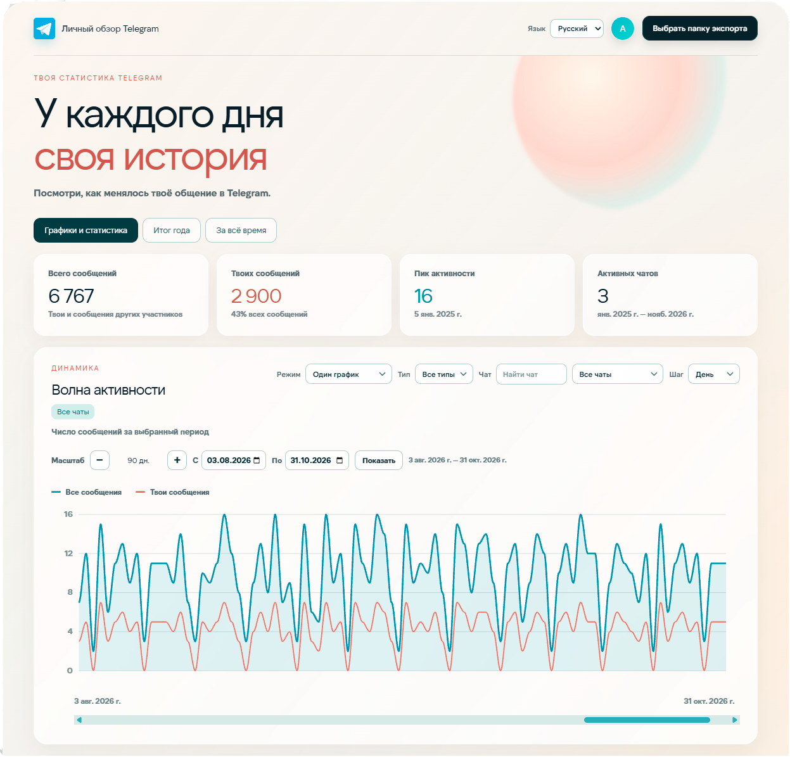

# TgPulse — бета

Локальная страница с графиками и итогами твоей активности в Telegram. Открывается двойным кликом по `index.html`, работает без сервера и обрабатывает экспорт в браузере. Данные никуда не отправляются.

## Запуск

1. В **Telegram Desktop** открой **Настройки → Продвинутые настройки → Экспорт данных**. Выбери чаты, отключи фотографии и другие медиафайлы для быстрого экспорта, а внизу выбери формат **JSON**.
2. Дважды щёлкни `index.html`.
3. Нажми **«Выбрать папку экспорта»** и укажи папку с `result.json`. При выборе папки страница также покажет аватар. Можно открыть только `result.json`, но тогда аватар не загрузится.

Если экспорта пока нет, нажми **«Посмотреть демо на вымышленных данных»**.

## Что есть в бете

- График активности по всем чатам или по каждому чату, масштабирование, выбор дат и поиск чатов.
- Календарь, пики, серии, ритм переписки, популярные слова, стикеры и примерное время ответа.
- Вкладки **«Итог года»** с выбором года и **«За всё время»** по всему экспорту.
- Карточки итогов в PNG или PDF. Перед сохранением можно скрыть имена чатов, даты и точные числа.
- Русский и английский интерфейс.

## Скриншот

Подсчёт времени ответа приблизительный: без явной ссылки «Ответить» программа не всегда может отличить ответ от начала нового разговора. Тексты сообщений появляются только после нажатия **«Показать сообщения»**. При новом открытии страницы браузер снова попросит выбрать экспорт.

## Приватность и лицензия

Экспорт переписок обрабатывается локально. Папки `DataExport_*` и `result.json` исключены из Git. Перед публикацией карточек проверь, какие данные на них видны.

Проект находится в **бета-версии**. При разработке использовался ИИ **OpenAI Codex** для помощи с кодом, интерфейсом и документацией. Код и документацию стоит проверять перед использованием и дополнением.

Код проекта распространяется по [Apache License 2.0](LICENSE). Авторы и лицензии сторонней иконки и шрифта указаны в [ATTRIBUTION.md](ATTRIBUTION.md).

---

## English

**TgPulse beta** is a local Telegram activity dashboard. Export your chats as **JSON** in Telegram Desktop, then open `index.html` and choose the export folder. No server or upload is required. You can try the fictional demo first.

Explore charts, chat streaks, words, stickers, and yearly or all-time recap cards. Save cards as PNG or PDF, with optional privacy controls. Reply times are estimates. The interface supports Russian and English.

The project was developed with assistance from **OpenAI Codex** for code, interface text, and documentation. Licensed under [Apache License 2.0](LICENSE); third-party credits are in [ATTRIBUTION.md](ATTRIBUTION.md).
