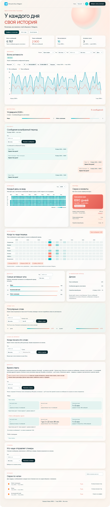

# TgPulse — бета

Локальная страница с графиками и итогами твоей активности в Telegram. Открывается двойным кликом по `index.html`, работает без сервера и обрабатывает экспорт в браузере. Данные никуда не отправляются.

## Почему переписка остаётся у тебя

TgPulse читает выбранный тобой `result.json` **только в браузере на твоём компьютере**. В приложении нет сервера, сетевых запросов, аналитики и внешних скриптов: HTML, JavaScript, шрифты и иконка лежат в скачанной папке. Экспорт не загружается на GitHub и исключён из Git. Тексты сообщений показываются лишь после нажатия кнопки, а карточки сохраняются на твоё устройство.

Абсолютную безопасность любого компьютера обещать нельзя, но сам TgPulse не отправляет переписку третьим лицам. Исходный код открыт для проверки.

## Скачать и запустить

1. На странице репозитория нажми зелёную кнопку **Code → Download ZIP**. Распакуй скачанный ZIP в удобную папку. Установка не нужна.
2. Дважды щёлкни `index.html` в распакованной папке.
3. В **Telegram Desktop** открой **Настройки → Продвинутые настройки → Экспорт данных**. Отметь **Информация об аккаунте**, **Список контактов** и **Личные чаты**. Для быстрого экспорта отключи фотографии и другие медиафайлы.
4. **ВАЖНО: в самом низу окна экспорта выбери машиночитаемый формат JSON.** Дождись окончания экспорта.
5. На открытой странице нажми **«Выбрать папку экспорта»** и укажи папку с `result.json`. При выборе папки страница также покажет аватар. Можно открыть только `result.json`, но тогда аватар не загрузится.

Если экспорта пока нет, нажми **«Посмотреть демо на вымышленных данных»**.

## Что есть в бете

- График активности по всем чатам или по каждому чату, масштабирование, выбор дат и поиск чатов.
- Календарь, пики, серии, ритм переписки, популярные слова, стикеры и примерное время ответа.
- Вкладки **«Итог года»** с выбором года и **«За всё время»** по всему экспорту.
- Карточки итогов в PNG или PDF. Перед сохранением можно скрыть имена чатов, даты и точные числа.
- Русский и английский интерфейс.

## Скриншот

Подсчёт времени ответа приблизительный: без явной ссылки «Ответить» программа не всегда может отличить ответ от начала нового разговора. Тексты сообщений появляются только после нажатия **«Показать сообщения»**. При новом открытии страницы браузер снова попросит выбрать экспорт.

## Приватность и лицензия

Экспорт переписок обрабатывается локально. Папки `DataExport_*` и `result.json` исключены из Git. Перед публикацией карточек проверь, какие данные на них видны.

Проект находится в **бета-версии**. При разработке использовался ИИ **OpenAI Codex** для помощи с кодом, интерфейсом и документацией. Код и документацию стоит проверять перед использованием и дополнением.

Код проекта распространяется по [Apache License 2.0](LICENSE). Авторы и лицензии сторонней иконки и шрифта указаны в [ATTRIBUTION.md](ATTRIBUTION.md).

---

## English

**TgPulse beta** is a local Telegram activity dashboard. Click the green **Code → Download ZIP** button, extract the ZIP, and double-click `index.html`; no installation is needed. In Telegram Desktop, export **Account information**, **Contacts list**, and **Personal chats**. **At the bottom of the export dialog, choose machine-readable JSON.** Then select the export folder in TgPulse. No server or upload is required. You can try the fictional demo first.

**Privacy:** TgPulse reads `result.json` in your browser. The app has no server, network requests, analytics, or external scripts; the export stays on your computer and is excluded from Git. No software can promise absolute safety on every device, but TgPulse itself does not transmit your chats.

Explore charts, chat streaks, words, stickers, and yearly or all-time recap cards. Save cards as PNG or PDF, with optional privacy controls. Reply times are estimates. The interface supports Russian and English.

The project was developed with assistance from **OpenAI Codex** for code, interface text, and documentation. Licensed under [Apache License 2.0](LICENSE); third-party credits are in [ATTRIBUTION.md](ATTRIBUTION.md).
